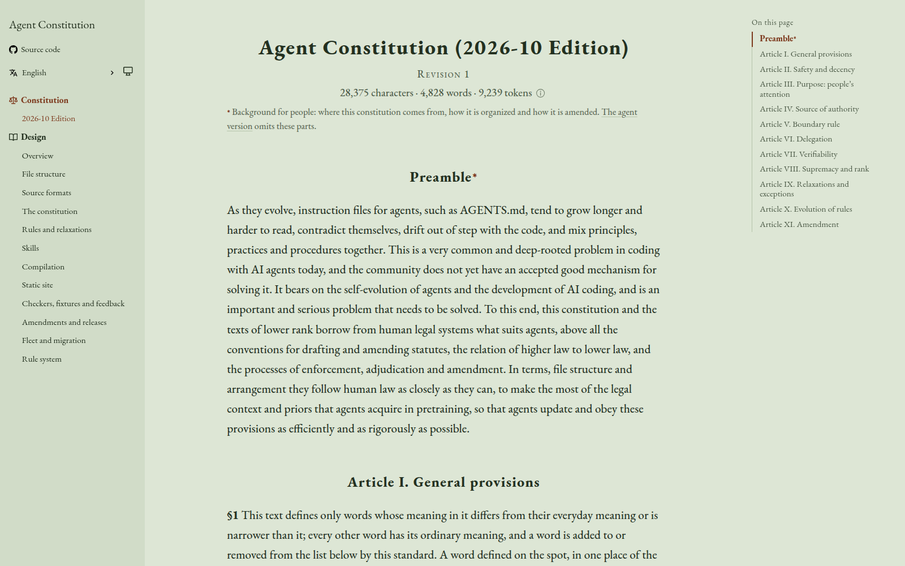

<div align="center">

<a href="https://agent-constitution.luolc.com/"><picture><source media="(prefers-color-scheme: dark)" srcset=".github/assets/icon-dark.svg"></picture></a>

# Agent Constitution

### One constitution for every coding agent, and the rules beneath it.

**A constitution, a library of rules and a set of skills,**<br>
written once and compiled into the instruction file each agent reads,<br>
so that AGENTS.md stays short, consistent and checked.

[](https://agent-constitution.luolc.com/) [](https://github.com/Luolc/agent-constitution/actions/workflows/ci.yml) [](constitution/2026-10/index.toml) [](LICENSE) [](LICENSE-CC-BY-4.0)

**[Read online](https://agent-constitution.luolc.com/)** &nbsp;·&nbsp; **[Design](https://agent-constitution.luolc.com/design/)** &nbsp;·&nbsp; **[Rules](rules/)** &nbsp;·&nbsp; **[Skills](skills/)** &nbsp;·&nbsp; **English** · [简体中文](README.zh-CN.md)

<br>

<picture>
  <source media="(prefers-color-scheme: dark)" srcset=".github/assets/site-dark.png">
  
</picture>

</div>

<br>

## Is it for you?

Instruction files for coding agents, such as AGENTS.md, tend to grow longer
and harder to read as they evolve. They contradict themselves, drift out of
step with the code, and mix principles, practices and procedures together.
This repo takes a different route, borrowed from how laws are written:

- **A constitution** holds the few stable principles and the governance
  rules: what binds whom, what only a person may decide, and how the rules
  and the constitution change. It names no command or tool.
- **Rules** refine the constitution into concrete practices, one
  requirement each, with a way to tell whether it is broken.
- **Skills** say how to meet a rule: steps, templates, commands.

These are compiled, together with a private overlay that holds one user's
own values and rules, into the instruction file that Claude Code, Codex
and Grok read.

It is for you if you run coding agents across several repositories and
want one set of principles they all follow, with rules you can choose and
check. The constitution is in force and builds into Markdown; the rule
system and its compiler are designed but not written yet.

## Quick start

**Read it.** The constitution is on
**[agent-constitution.luolc.com](https://agent-constitution.luolc.com/)**,
in English and Chinese, each with a shorter version for agents. In the
repo, the built text is under
[`constitution/2026-10/generated/`](constitution/2026-10/generated/):
[English](constitution/2026-10/generated/constitution.en.md),
[中文](constitution/2026-10/generated/constitution.zh.md).

**Build it.** You need [uv](https://docs.astral.sh/uv/):

```sh
git clone https://github.com/Luolc/agent-constitution.git
cd agent-constitution
uv sync                          # the tools and their checkers, into .venv
uv run constitution-build        # the sources into the generated Markdown
```

## How it fits together

<picture>
  <source media="(prefers-color-scheme: dark)" srcset=".github/assets/architecture-dark.svg">
  
</picture>

- **Built today:** the constitution's sources, one TOML file per section in
  both languages, are checked and built by `constitution-build` into
  Markdown.
- **Designed, not built yet:** rules form a tree, each with one parent,
  and a repository picks the ones it uses in a rule set, pinned by a lock
  file. The compiler turns the rule set and the constitution into
  AGENTS.md, the skills those rules need, and the checks and hooks that
  run them. What the checks cannot settle goes to a reviewer, an agent;
  where the reviewer and a check disagree, the check is fixed, so the
  rules improve with use. See [Rule system](docs/design/rule-system.md).

## Development

The repo's layout, source formats, checks and releases are in the
[design](docs/design/README.md); the commands are in
[AGENTS.md](AGENTS.md) (Checks). In short:

- `constitution/2026-10/` holds the sources of the 2026-10 edition:
  `index.toml` and one directory per article under `articles/`, one file
  per section, each in English and Chinese. Edit them and rebuild with
  `uv run constitution-build`, never the files in `generated/`
  ([The constitution](docs/design/constitution.md),
  [Source formats](docs/design/source-formats.md)).
- `rules/` holds the general rules, one TOML file per rule in both
  languages; `skills/` the general skills, one directory per skill with
  its `SKILL.md`, in English.
- `tools/` is a uv workspace of three Python projects: `tools/compiler`
  (the constitution build), `tools/site` (the checks of the static site,
  see [Static site](docs/design/static-site.md)) and `tools/checks` (the
  checks this repo runs on its own changes).

Install the commit hooks once with `uv run pre-commit install`;
`uv run pre-commit run --all-files` runs them all.

## License

The text of the constitution, the rules and the skills (`constitution/`,
`rules/`, `skills/`) is licensed under
[CC BY 4.0](LICENSE-CC-BY-4.0). Everything else, including the code under
`tools/`, is licensed under [Apache-2.0](LICENSE). The website's theme
(`web/themes/hugo-book`, a submodule) and the icons from Octicons keep
their own MIT licenses.
