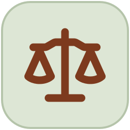
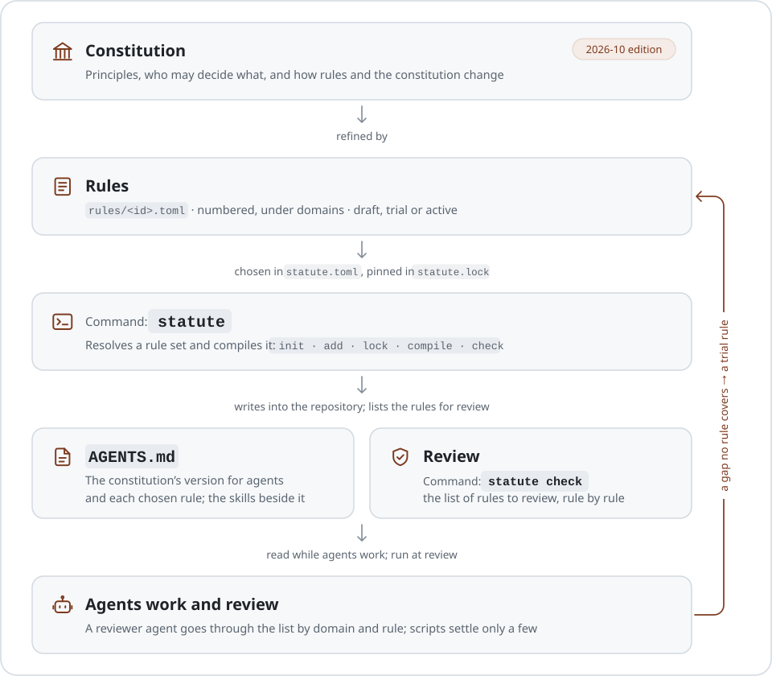

<div align="center">

<a href="https://agent-constitution.luolc.com/"><picture><source media="(prefers-color-scheme: dark)" srcset=".github/assets/icon-dark.svg"></picture></a>

# Agent Constitution

### One constitution for every coding agent, and the rules beneath it.

**A constitution and a library of rules,**<br>
compiled for each repository into the AGENTS.md its agents read,<br>
with checks that tell whether the rules were kept.

[](https://github.com/Luolc/agent-constitution/actions/workflows/ci.yml) [](#license)

**[Read online](https://agent-constitution.luolc.com/)** &nbsp;·&nbsp; **[Design](https://agent-constitution.luolc.com/design/)** &nbsp;·&nbsp; **[Rules](rules/)** &nbsp;·&nbsp; **English** · [简体中文](README.zh-CN.md)

</div>

<br>

Instruction files for coding agents, such as AGENTS.md, tend to grow
longer and harder to read as they evolve: they contradict themselves,
drift out of step with the code, and mix principles, practices and
procedures together. This repo writes them the way laws are written. A
short constitution holds the principles and says who may decide what;
numbered rules refine it, one requirement each, with a way to tell
whether it was broken; and a command, `statute`, compiles the rules a
repository chooses into its AGENTS.md and, at review, lists the rules
the reviewer goes through.

<picture>
  <source media="(prefers-color-scheme: dark)" srcset=".github/assets/architecture-dark.svg">
  
</picture>

## The constitution

The 2026-10 edition is in force. Its eleven articles cover safety, whose
authority an agent acts on, delegation, verification, how rules rank and
change, and how the constitution itself is amended. It names no command
or tool, so it stays stable while the rules below it change.

It comes as the full text and a shorter version for agents, without
what only people need. Read it on the
**[website](https://agent-constitution.luolc.com/)**, or in the repo
under [`constitution/2026-10/generated/`](constitution/2026-10/generated/).
The sources are TOML, one file per section, in
[`constitution/2026-10/`](constitution/2026-10/); how they are numbered
and amended is in [The constitution](docs/design/constitution.md).

## Rules

Each rule is one file, [`rules/<id>.toml`](rules/). Its ID is a number,
never reused; its text is a statement, a reason and a verification,
short enough to be checked. Rules hang under domains such as security,
collaboration, verification and documentation, and each one cites the
provisions of the constitution it refines. A rule starts as `trial`, and
so does a convention that agents write down when they find a gap no rule
covers; it becomes `active` once it has held up in real work. A rule is
never deleted: it is superseded or repealed.

The format, the rule tree, packs and the review loop are in
[Rule system](docs/design/rule-system.md).

## Command: `statute`

`statute` is the rule system's command, in Rust, in
[`crates/statute`](crates/statute/). It is under development: it reads
this repo's rules from a clone it keeps in `~/.cache/statute/`, and on
crates.io, 0.0.1 is a placeholder that held the name; the command starts
with 0.1.0. Build it from a clone:

```sh
git clone https://github.com/Luolc/agent-constitution.git
cargo install --path agent-constitution/crates/statute
```

Then, once per machine and in the repository the agents work in:

```sh
statute init --global # write ~/.config/statute/config.toml and clone this repo
statute init          # write statute.toml; public or not as GitHub shows it, or say --public / --private
statute add R43       # enable rule 43, and write statute.lock
statute lock          # resolve statute.toml again after editing it by hand
statute compile       # write AGENTS.md, the skills and the checks
statute check         # list the enabled rules for review
statute site          # a local site of every rule, private ones too, in .statute/site
```

A repository can use two kinds of rules. A rule source publishes rules
for other repositories, in `rules/` at its top as this repo does, and a
rule set names it in `[sources]` by a git address or a path. A
repository's own rules bind it alone: they live in `.statute/rules/`
(today still `rules/` next to `statute.toml`, until that is built), are
cited as `L12`, and no other repository can name them.

Most rules cannot be decided by a script, so the work is reviewed rule
by rule: the reviewer runs `statute check` to get the enabled rules by
domain, marked `review` when no script can decide them, and goes through
them one by one. A rule with a script check shows `pass`, `violation` or
`inconclusive`, and `statute check` exits with status 1 on a violation. It
may run in CI, but not as a commit hook: a check may be slow.
`statute explain <id>` says why a rule is enabled, and `statute
--help` lists the rest. What is built so far is in
[The command and the first version](docs/design/statute-command.md#the-command-and-the-first-version).

## Development

The [design](docs/design/README.md) covers the layout, the source formats,
the checks and releases; [AGENTS.md](AGENTS.md) lists the commands. In
short, you need [uv](https://docs.astral.sh/uv/) and the Rust toolchain:

```sh
uv sync                          # the Python tools, into .venv
uv run pre-commit install        # the commit hooks
uv run constitution-build        # rebuild the generated constitution
cargo test --locked              # the tests of statute
```

## License

The text of the constitution, the rules and the skills (`constitution/`,
`rules/`, `skills/`) is licensed under
[CC BY 4.0](LICENSE-CC-BY-4.0). Everything else, including the code under
`tools/` and `crates/`, is licensed under [Apache-2.0](LICENSE). The
website's theme (`web/themes/hugo-book`, a submodule) and the icons from
Octicons keep their own MIT licenses.
