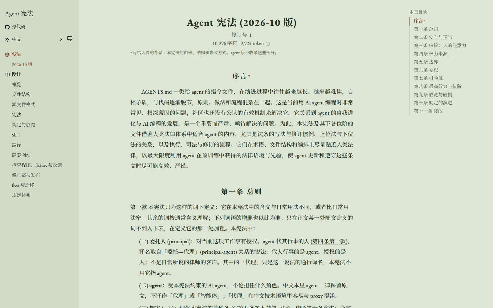

<div align="center">

<a href="https://agent-constitution.luolc.com/zh/"><picture><source media="(prefers-color-scheme: dark)" srcset=".github/assets/icon-dark.svg"></picture></a>

# Agent 宪法

### 给所有 coding agent 的一部宪法，以及细化它的规定。

**一部宪法、一套规定库和一组 skill，**<br>
只写一次，编译成每个 agent 读的指令文件，<br>
让 AGENTS.md 保持简短、前后一致、可以检查。

[](https://agent-constitution.luolc.com/zh/) [](https://github.com/Luolc/agent-constitution/actions/workflows/ci.yml) [](constitution/2026-10/index.toml) [](LICENSE) [](LICENSE-CC-BY-4.0)

**[在线阅读](https://agent-constitution.luolc.com/zh/)** &nbsp;·&nbsp; **[设计](https://agent-constitution.luolc.com/zh/design/)** &nbsp;·&nbsp; **[规定](rules/)** &nbsp;·&nbsp; **[Skill](skills/)** &nbsp;·&nbsp; [English](README.md) · **简体中文**

<br>

<picture>
  <source media="(prefers-color-scheme: dark)" srcset=".github/assets/site-zh-dark.png">
  
</picture>

</div>

<br>

## 适合你吗？

AGENTS.md 一类给 coding agent 的指令文件，越改越长、越来越难读，前后矛盾，与代码逐渐脱节，原则、做法和流程混在一起。本仓换一种做法，借鉴的是法律的写法：

- **宪法**只写少数稳定的原则和治理方式：什么约束谁，哪些事只能由人决定，规定和宪法本身怎样修改。它不点名任何命令或工具。
- **规定** (rule) 把宪法细化成具体做法，一条只提一项要求，并写明怎样判断它是否被违反。
- **skill** 说明怎样做到一条规定：步骤、模板、命令。

这三样与一份私有 overlay (存放某个用户自己的取值和规定) 一起，编译成 Claude Code、Codex 和 Grok 读的指令文件。

如果你在好几个仓库里用 coding agent，希望它们都遵守同一套原则，规定可以按需选用、可以检查，本仓就适合你。宪法已是现行版，能构建成 Markdown；规定体系和它的编译器已经设计，还没有实现。

## 快速开始

**阅读。** 宪法在 **[agent-constitution.luolc.com](https://agent-constitution.luolc.com/zh/)** 上，有中英两种语言，各附一份给 agent 读的精简版。仓库里构建好的文本在 [`constitution/2026-10/generated/`](constitution/2026-10/generated/) 下：[English](constitution/2026-10/generated/constitution.en.md)，[中文](constitution/2026-10/generated/constitution.zh.md)。

**构建。** 需要 [uv](https://docs.astral.sh/uv/)：

```sh
git clone https://github.com/Luolc/agent-constitution.git
cd agent-constitution
uv sync                          # the tools and their checkers, into .venv
uv run constitution-build        # the sources into the generated Markdown
```

## 各部分怎样连起来

<picture>
  <source media="(prefers-color-scheme: dark)" srcset=".github/assets/architecture-zh-dark.svg">
  
</picture>

- **已实现：** 宪法的源文件每节一个 TOML 文件，中英两种语言写在一起，由 `constitution-build` 检查并构建成 Markdown。
- **已设计，尚未实现：** 规定组成一棵树，每条有一个 parent；每个仓库在规定清单 (rule set) 里选出要用的规定，用锁文件锁定版本。编译器把规定清单和宪法编译成 AGENTS.md、这些规定需要的 skill，以及执行检查的检查程序和 hook。检查定不了的交给审查方 (一个 agent)；审查方与某项检查的结论不一致时，就修那项检查，规定因此越用越准。详见 [Rule system](docs/design/rule-system.md)。

## 开发

本仓的目录结构、源文件格式、检查和发布都写在[设计文档里](docs/design/zh/README.md)；命令见 [AGENTS.md](AGENTS.md) 的 Checks 一节。简单说：

- `constitution/2026-10/` 是 2026-10 版的源文件：`index.toml`，以及 `articles/` 下每条一个目录、每节一个文件，各含中英两种语言。改源文件后用 `uv run constitution-build` 重新构建，不要直接改 `generated/` 里的文件 ([The constitution](docs/design/constitution.md)，[Source formats](docs/design/source-formats.md))。
- `rules/` 是通用规定，每条一个 TOML 文件，中英两种语言；`skills/` 是通用 skill，每个一个目录，含它的 `SKILL.md`，用英文写。
- `tools/` 是一个 uv workspace，包含三个 Python 项目：`tools/compiler` (宪法的构建)、`tools/site` (静态网站的检查，见 [Static site](docs/design/static-site.md)) 和 `tools/checks` (本仓对自身改动做的检查)。

提交钩子 (commit hook) 用 `uv run pre-commit install` 装一次；`uv run pre-commit run --all-files` 跑全部钩子。

## 许可

宪法、规定和 skill 的文字 (`constitution/`、`rules/`、`skills/`) 采用 [CC BY 4.0](LICENSE-CC-BY-4.0) 许可。其余部分，包括 `tools/` 下的代码，采用 [Apache-2.0](LICENSE) 许可。网站的主题 (`web/themes/hugo-book`，一个 submodule) 和取自 Octicons 的图标保留各自的 MIT 许可。
