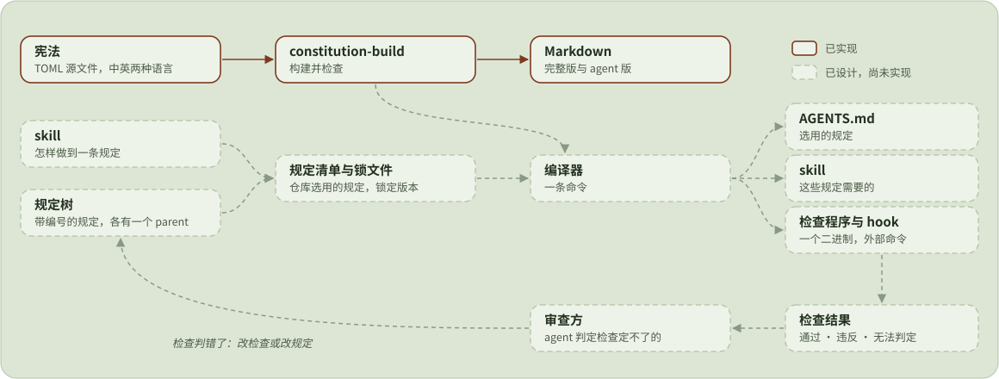

<div align="center">

<a href="https://agent-constitution.luolc.com/zh/"><picture><source media="(prefers-color-scheme: dark)" srcset=".github/assets/icon-dark.svg"></picture></a>

# Agent 宪法

### 给所有 coding agent 的一部宪法，以及细化它的规定。

**一部宪法和一套规定库，**<br>
按仓库编译成 agent 读的 AGENTS.md，<br>
再用检查判断规定有没有守住。

[](https://github.com/Luolc/agent-constitution/actions/workflows/ci.yml) [](#许可)

**[在线阅读](https://agent-constitution.luolc.com/zh/)** &nbsp;·&nbsp; **[设计](https://agent-constitution.luolc.com/zh/design/)** &nbsp;·&nbsp; **[规定](rules/)** &nbsp;·&nbsp; [English](README.md) · **简体中文**

</div>

<br>

AGENTS.md 一类给 coding agent 的指令文件，越改越长、越来越难读：前后矛盾，与代码脱节，原则、做法和流程混在一起。本仓照法律的写法来写它们：一部简短的宪法写原则，规定谁能决定什么；带编号的规定细化宪法，每条只提一项要求，并写明怎样判断它有没有被违反；命令 `statute` 把一个仓库选中的规定编译进它的 AGENTS.md，并在审查时列出审查方要逐条过的规定。

<picture>
  <source media="(prefers-color-scheme: dark)" srcset=".github/assets/architecture-zh-dark.svg">
  
</picture>

## 宪法

现行的是 2026-10 版，共十一条，讲安全、agent 依谁的授权行事、委托、验证、规定的位阶与演进，以及宪法本身怎样修改。宪法不提任何命令或工具，所以下面的规定怎么变，它都不用跟着变。

宪法分全文和给 agent 读的精简版，精简版省去只写给人看的部分。可以在 **[网站](https://agent-constitution.luolc.com/zh/)** 上读，也可以看仓库里的 [`constitution/2026-10/generated/`](constitution/2026-10/generated/)。源文件是 TOML，每节一个文件，在 [`constitution/2026-10/`](constitution/2026-10/) 下；编号和修改的规矩见 [宪法](docs/design/zh/constitution.md)。

## 规定

每条规定是一个文件 [`rules/<id>.toml`](rules/)。规定的 ID 是数字，永不复用；正文分要求、理由和判定方法三部分，都写得够短，能够检查。规定挂在 domain 下面，例如安全、协作、验证、文档，每条都注明它细化的是宪法的哪些条款。规定先是 `trial` (试行) 状态，agent 发现某件事没有规定覆盖、动手写下的约定也一样，在实际工作中站住了脚，再转为 `active`。规定从不删除，只会被取代 (superseded) 或废止 (repealed)。

文件格式、规定树、规定包和审查循环见 [规定体系](docs/design/zh/rule-system.md)。

## Command: `statute`

`statute` 是规定体系的命令，用 Rust 写，在 [`crates/statute`](crates/statute/)。它还在开发中：目前只从本地磁盘上的源读规定，也就是本仓的一份检出；crates.io 上的版本还只是占位。从源码构建：

```sh
git clone https://github.com/Luolc/agent-constitution.git
cargo install --path agent-constitution/crates/statute
```

然后在 agent 工作的那个仓库里 (这里假定克隆的目录就在它旁边)：

```sh
statute init --source ../agent-constitution  # 写出 statute.toml；是否公开按 GitHub 显示的写，也可以用 --public / --private 指定
statute add R43       # 启用规定 43，并写出 statute.lock
statute lock          # 手改 statute.toml 之后重新解析
statute compile       # 写出 AGENTS.md、skill 和检查
statute check         # 列出已启用的规定，供审查
```

大多数规定没法用脚本判定，所以工作要逐条规定地审：审查方运行 `statute check`，拿到按 domain 分组的已启用规定，脚本判定不了的标 `review`，再逐条过。有脚本检查的规定结果是 `pass`、`violation` 或 `inconclusive`，有规定被违反时 `statute check` 的退出码为 1。它也可以在 CI 里运行，但不作为提交钩子，因为检查可能很慢。`statute explain <id>` 说明某条规定为什么被启用，其余命令见 `statute --help`。目前做到哪一步，见 [命令与第一版](docs/design/zh/statute-command.md#the-command-and-the-first-version)。

## 开发

[设计](docs/design/zh/README.md) 写了目录结构、源文件格式、检查和发布，[AGENTS.md](AGENTS.md) 列了各条命令。简单说，需要 [uv](https://docs.astral.sh/uv/) 和 Rust 工具链：

```sh
uv sync                          # Python 工具，装进 .venv
uv run pre-commit install        # 提交钩子
uv run constitution-build        # 重新生成宪法
cargo test --locked              # statute 的测试
```

## 许可

宪法、规定和 skill 的文字 (`constitution/`、`rules/`、`skills/`) 采用 [CC BY 4.0](LICENSE-CC-BY-4.0) 许可。其余部分，包括 `tools/` 和 `crates/` 下的代码，采用 [Apache-2.0](LICENSE) 许可。网站的主题 (`web/themes/hugo-book`，一个子模块) 和取自 Octicons 的图标沿用各自的 MIT 许可。
